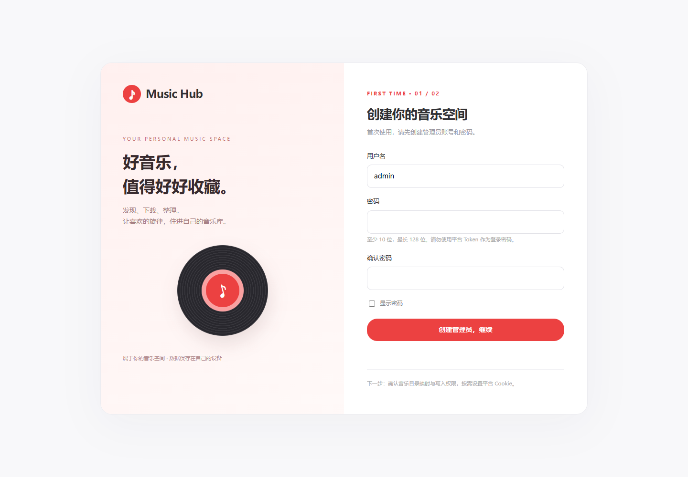

# Music Hub

在自己的 NAS 上搜索音乐、批量下载、按计划补充曲库。一个入口管理账号、音乐目录、平台登录和下载任务。

Music Hub 提供统一的红白音乐界面，使用 Go Music DL 处理音频下载。使用单一 Docker 镜像：界面、下载引擎、首次初始化都在一个容器内，下载引擎只监听容器内回环地址。



[快速开始](#快速开始) · [NAS 目录映射](#nas-目录映射) · [网易云扫码登录](#网易云扫码登录) · [搜索与批量下载](#搜索与批量下载) · [升级与备份](#升级与备份) · [常见问题](#常见问题)

## 能做什么

- **搜索与分页**：网易云、QQ 音乐、酷我、酷狗、咪咕；默认每页 20 首，可切换 50 首，支持上一页、下一页和跳页。翻页会向平台请求后续结果。
- **批量下载**：单曲下载、多选、全选当前页；勾选可跨分页、关键词和来源保留，每次最多提交 200 首。
- **持续运行**：任务在后台执行，关闭网页不影响下载；队列、结果和设置保存在数据卷。
- **任务管理**：进度汇总、排队去重、取消等待项、失败重试，以及按音乐类型搜索歌单的批量任务。
- **定时轮换**：每日、每周、每月执行；多种音乐类型按顺序轮换，支持配额、轮换预览和运行中调整目标。
- **统一设置**：首次创建管理员、正式登录页、密码修改/找回、目录浏览与写权限检查、网易云扫码保存凭据。

## 快速开始

需要 Docker Engine 和 Docker Compose v2。宿主机无需安装 Python、Go 或 Node.js。

```sh
mkdir -p music-hub && cd music-hub
curl -fsSLo compose.yaml https://raw.githubusercontent.com/io-aoleo/music-hub/main/compose.yaml
# 可选：先在 .env 写入 ENGINE_DOWNLOAD_PATH=/你的/NAS/音乐目录
docker compose up -d
```

默认从 [Docker Hub](https://hub.docker.com/r/ioaoleo/music-hub) 拉取预构建镜像 `ioaoleo/music-hub:latest`，支持 Linux AMD64 和 ARM64，宿主机无需编译。也可使用 [GHCR](https://github.com/io-aoleo/music-hub/pkgs/container/music-hub) 的 `ghcr.io/io-aoleo/music-hub:latest`。两个仓库的用户名不同，请按完整地址填写。

想固定稳定版本，在 `.env` 设置 `MUSIC_HUB_IMAGE=ioaoleo/music-hub:1.0.0`。`latest` 会随默认分支更新；版本标签用于固定版本。启动后打开：

```text
http://你的设备地址:9985
```

第一次使用按页面提示：

1. 创建管理员用户名和密码。密码为 10～128 位，没有通用默认密码。
2. 确认音乐目录映射，点击「检查写入权限」。
3. 按需扫码登录网易云，或填写其他平台 Cookie。
4. 回到「发现音乐」开始搜索和下载。

默认音乐保存在项目目录下的 `data/music`。管理员、任务和引擎配置默认使用 Docker 命名卷。内部服务令牌自动生成，无需手工准备 `.env`。

检查服务状态：

```sh
docker compose ps -a
```

正常情况下只有一个 `music-hub-hub-1` 容器，状态为 healthy。初始化在启动时完成，界面与引擎都以 UID 1000 运行；引擎只监听 `127.0.0.1:9981`，日常只访问 9985。

## NAS 目录映射

想把歌曲下载到已有曲库时，在项目目录新建 `.env`，写入自己的真实宿主机目录：

```dotenv
# 飞牛示例，请按自己的设备修改。
ENGINE_DOWNLOAD_PATH=/vol1/1000/music
HUB_PORT=9985
```

然后运行或重新创建容器：

```sh
docker compose up -d
```

这个例子的映射是：

```text
飞牛 /vol1/1000/music  →  容器 /music
飞牛 /vol1/1000/music/华语  →  容器 /music/华语
```

网页「路径与 Token」可填写自己的宿主机绝对目录并生成 `ENGINE_DOWNLOAD_PATH` 配置；将生成行更新到原项目 `.env`（保留其他配置），使用原 Compose 项目名称重新部署后生效。页面会分别显示当前映射和待应用配置，不会把生成配置当作挂载已变更。更换目录不会自动搬迁旧歌曲，请等待下载结束后操作。

网页「路径与 Token」显示当前配置的映射，支持浏览、创建和选择 `/music` 内的子目录。网页下载路径填写容器路径，例如 `/music/华语`，不要填写 `/vol1/...`。

容器中的界面和引擎进程都使用 **UID 1000**。已有 NAS 目录需要允许这个用户读取、创建和写入文件，且不能只读挂载。系统会实际测试写入，并拒绝越界路径和指向挂载外的符号链接；初始化时不会递归修改已有曲库权限。

修改 `.env` 的挂载后需重新创建容器，单独执行 `docker compose restart` 不会更新挂载。

## 网易云扫码登录

进入 **路径与 Token → 网易云音乐 → 扫码登录网易云**：

1. 网页生成二维码，显示剩余有效时间。
2. 打开网易云音乐 App 的扫一扫，扫描网页二维码。
3. 网页显示「已扫码」后，在手机上确认登录。
4. 显示「登录成功」后，凭据自动保存到当前设备，无需再复制或点击「保存设置」。

二维码过期可刷新；关闭弹窗会停止状态检查。网络失败会提示重试。已经在手机确认且保存的登录，不会因关闭弹窗而被撤销。

扫码保存的是 **网易云平台 Cookie（登录凭据）**，不是 Music Hub 管理员密码，也不是内部服务 Token。登录成功不会回显 Cookie，且不会覆盖未保存的下载路径或其他平台输入。服务重启后凭据仍保留。

其他平台仍可手动填写 Cookie。留空保留已有值，勾选「清除此平台凭据」后保存才会删除对应凭据。

## 搜索与批量下载

输入关键词并选择音乐来源后开始搜索。分页栏支持翻页和跳页，每页数量可选 20 或 50；新搜索或切换来源从第一页开始，已勾选歌曲继续保留。

「全选当前结果」只选择这一页，不会自动选择平台的全部结果。可跨页累计勾选后点击「批量下载」，也可随时清空选择。

下载中心提供：

- 等待、下载中、完成、失败/中断的数量和进度。
- 最近 200 条详细记录，包含成功、失败及取消结果。
- 取消尚未开始的歌曲；失败、中断或已取消的歌曲可重试。
- 对已在排队或执行中的同一来源、同一歌曲去重。

默认两个下载线程，队列最多容纳 1000 首待处理歌曲。重启后，尚未执行的队列继续处理，正在执行的项目标记为中断，可由用户重试；已保存的音频由引擎去重。正在进行的网络请求需要等待完成或超时，不能瞬间撤销。

搜索结果不代表一定有下载权限。部分歌曲需要有效 Cookie 或相应会员权限，也可能因为资源不可用、平台限流而下载失败。错误会保留在队列中，可更新凭据、稍后重试或更换来源。

## 定时任务与类型轮换

「批量与定时」按音乐类型寻找歌单并执行下载，可设置类型、每类歌单数、并发和下载目标。支持 Live/现场，排除 DJ/混音。

多选类型默认按勾选顺序轮换，例如每日选择：

```text
流行 → 欧美 → 粤语 → 流行 → ……
```

每日、每周、每月都在每次触发时切换到下一类型；也可选择每次执行全部类型。页面显示后续安排，时间统一为 **北京时间（Asia/Shanghai）**。

只有成功创建任务才推进轮次。服务离线或已有任务占用时不跳过类型，也不集中补跑错过的日期。手动任务不推进轮换。

- 保存计划只影响未来任务。
- 运行中可修改本次下载目标，0 表示不限；已发出的请求仍会结束。
- 历史任务可「载入参数修改」后创建新任务，原记录保留。
- 按类型执行的任务在重启后标记中断，不自动重跑整张歌单。

## 升级与备份

升级前备份 `.env`、任务数据卷、引擎数据卷，并保留音乐目录。

```sh
docker compose pull
docker compose up -d
```

从双容器版升级时，先备份并保留原 Compose 和 `.env`，下载新版 `compose.yaml` 后，使用原项目名称执行 `docker compose up -d --remove-orphans`。这会移除旧 `engine` / `init` 容器，保留数据卷；引擎数据卷改挂载到同一容器的 `/data/engine`。首次启动后检查账号、平台登录和下载目录。升级时请等待正在下载的任务结束。旧编排备份见 [compose.legacy.yaml](compose.legacy.yaml)，仅用于回退。

**旧版升级不要覆盖自己的 `.env`。** 保留原 `HUB_TASKS_PATH`、`ENGINE_DATA_PATH` 和 `ENGINE_DOWNLOAD_PATH`，避免误切换到新的空数据卷。

旧版 `.env` 中的管理员账号仅在本地尚无账号时迁移一次。第一次用旧账号登录后，页面会要求输入旧密码并设置新密码。之后可从 `.env` 删除 `HUB_PASSWORD`；再次启动不会用旧环境密码覆盖新密码。

普通 `docker compose down` 保留数据。**`docker compose down -v` 会删除命名卷中的账号、任务和引擎配置，不要用它作为普通升级步骤。**

旧的分离部署迁移、SQLite 一致性备份和大曲库索引导入见 [安装与迁移指南](docs/getting-started.md)。

## 配置与访问

`.env` 为可选文件，完整字段示例见 [.env.example](.env.example)。常用配置：

- `HUB_PORT`：对外端口，默认 `9985`。
- `HUB_BIND_ADDRESS`：监听地址，默认 `0.0.0.0`。
- `ENGINE_DOWNLOAD_PATH`：宿主机音乐目录，默认 `./data/music`。
- `HUB_TASKS_PATH`、`ENGINE_DATA_PATH`：任务和引擎数据位置，默认命名卷；升级保留已有值。
- `HUB_COOKIE_SECURE`：仅通过 HTTPS 访问时可设为 `true`，默认 `false`。
- `MUSIC_HUB_IMAGE`：镜像完整名称，可固定为已发布的版本标签。
- `ENGINE_GOPROXY`：仅源码构建时使用的 Go 依赖代理。

外网访问通过自己的反向代理提供 HTTPS，保持默认鉴权开启。管理员密码仅保存哈希；平台 Cookie 保存在引擎数据卷，内部服务令牌保存在共享配置卷，不传给浏览器。

## 常见问题

**忘记管理员密码**

在有 Docker 管理权限的终端执行，按提示输入两次新密码：

```sh
docker compose exec hub python scripts/reset_password.py
```

它只重置登录密码并使旧会话失效，不删除音乐、任务或平台凭据。

**提示目录不可写**

确认 `.env` 中宿主机路径存在、未只读挂载，并在 NAS 权限管理中授予 UID 1000 读写权限。随后重新创建容器，在设置中检查目录。不要对整块磁盘递归改权限。

**扫码成功但某首歌下载失败**

扫码只登录账号，不增加账号权限。可尝试其他歌曲或来源；凭据失效时重新扫码，平台限流时稍后重试。

**搜索或扫码暂时失败**

平台接口需要设备能访问互联网。检查设备网络、代理设置和平台状态，再重新搜索或刷新二维码；平台返回错误时，界面会显示失败，不会伪装成空结果。

**无法登录或登录后又回到登录页**

确认用户名和密码正确。若设置了 `HUB_COOKIE_SECURE=true`，需用 HTTPS 访问；通过 HTTP 访问时应恢复为 `false` 并重新创建 Hub。

**查看日志**

```sh
docker compose logs --tail=100 hub
```

## 飞牛 Docker 界面部署

1. 在飞牛文件管理中创建 Music Hub 项目目录，下载本仓库的 `compose.yaml`。
2. 在同目录创建 `.env`，设置 `ENGINE_DOWNLOAD_PATH=/vol1/你的用户目录/music`；这是你自己的宿主机目录。
3. 打开 Docker → Compose，创建项目并选择该文件，启动项目。
4. 浏览器打开 `http://飞牛地址:9985`，创建管理员并检查音乐目录写入权限。
5. 进入「路径与 Token」，扫码或填写平台凭据后搜索下载。

只需导入 Compose，不需要单独安装下载引擎，也不需要 Docker Socket 或 privileged 权限。Docker Hub 拉取失败时，可在 `.env` 设置 `MUSIC_HUB_IMAGE=ghcr.io/io-aoleo/music-hub:latest` 后重新执行 `docker compose pull` 和 `docker compose up -d`；固定版本用户替换为对应版本标签。公开镜像无需登录仓库，匿名拉取仍受平台速率限制和设备网络影响。

已有实例只切换镜像仓库时，保留原项目名称、端口、数据卷和目录映射，仅修改 `MUSIC_HUB_IMAGE`。下载包的镜像名可能不同，离线导入请使用发布页对应说明。

## 源码构建

```sh
git clone https://github.com/io-aoleo/music-hub.git
cd music-hub
docker compose -f compose.yaml -f compose.build.yaml up -d --build
```

GitHub Actions 会在 main 更新或推送版本标签时构建 AMD64/ARM64 镜像；只有检查通过才发布到 GHCR，并按仓库配置同步到 Docker Hub。普通 PR 只验证构建，不发布镜像。维护者配置和已有版本同步方法见 [镜像发布说明](docs/image-publishing.md)。

## 开发与验证

```sh
python -m venv .venv
# 激活虚拟环境后执行：
pip install -r requirements.txt
python -m unittest discover -s tests -v
node tests/test_ui.cjs
docker compose config --quiet
```

浏览器回归：先运行 `python tests/browser_server.py`，再用已安装的 Playwright 执行 `node tests/browser_flow.cjs`。该测试使用本地演示平台，覆盖首次设置、登录、目录、分页、多页选择、扫码状态、批量下载和手机布局；真实平台仍需单独联网验证。

当前 Gunicorn 必须保持一个 worker，以免多份定时器重复执行任务。单曲/多选队列使用 SQLite，按类型任务保留原子更新的 JSON 历史。架构与模块边界见 [架构说明](docs/architecture.md)，可选 CI 模板见 [checks.workflow.yml](docs/checks.workflow.yml)。

## 开源与许可

Music Hub 按 **AGPL-3.0** 发布，详见 [LICENSE](LICENSE) 和 [NOTICE](NOTICE)。

音频引擎基于 [guohuiyuan/go-music-dl](https://github.com/guohuiyuan/go-music-dl)，源码快照及上游许可保留在 `vendor/go-music-dl`。分页字段适配参考该引擎锁定版本的 [guohuiyuan/music-lib](https://github.com/guohuiyuan/music-lib)。本项目不声称引擎快照等同于某个未经修改的上游提交。
