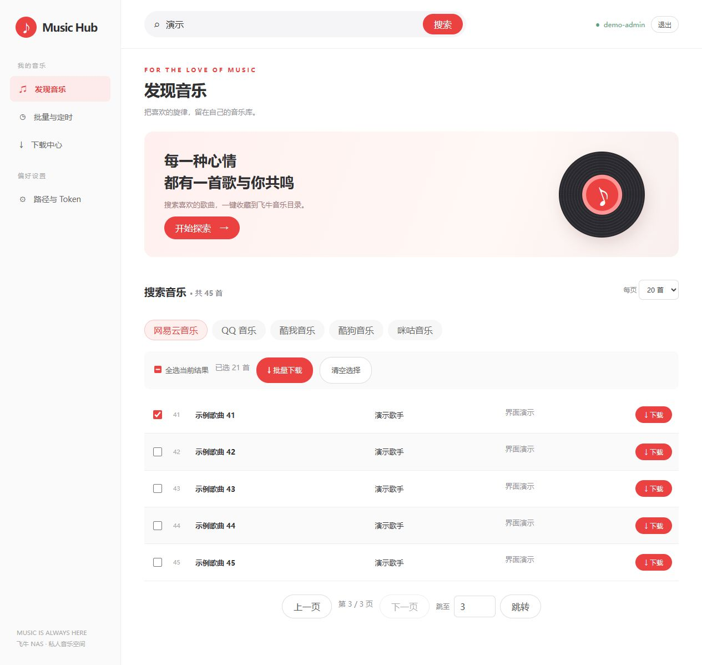
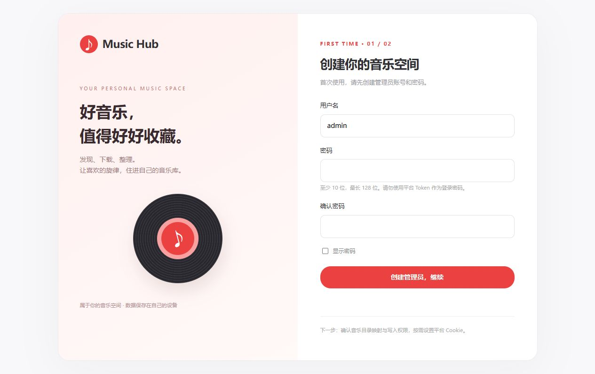
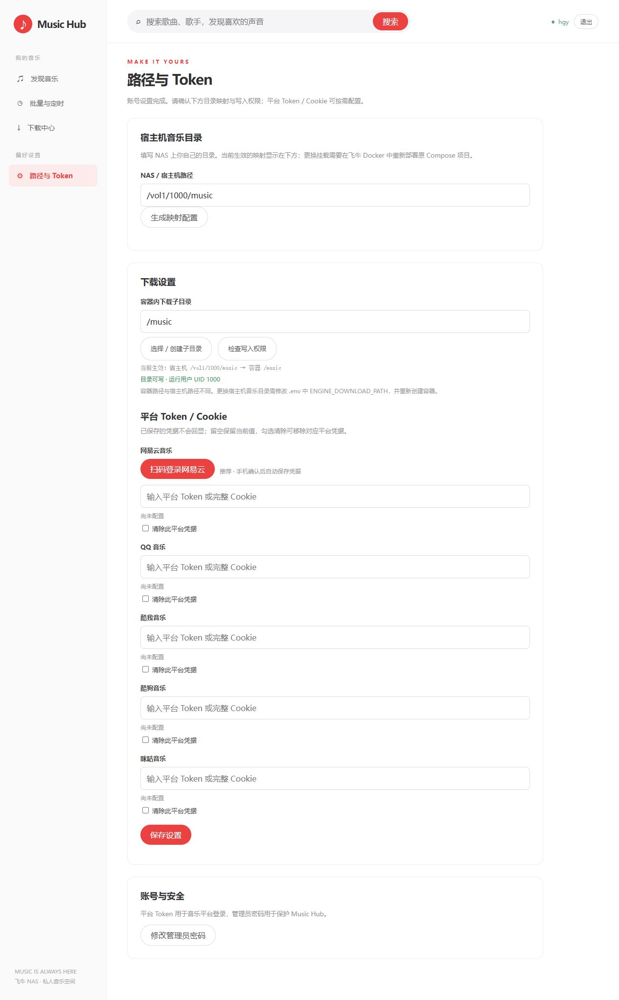
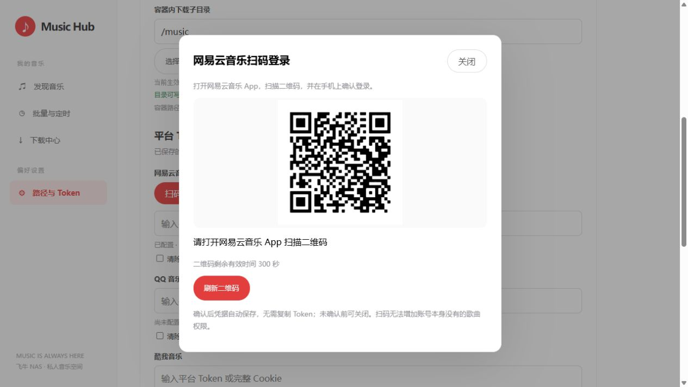
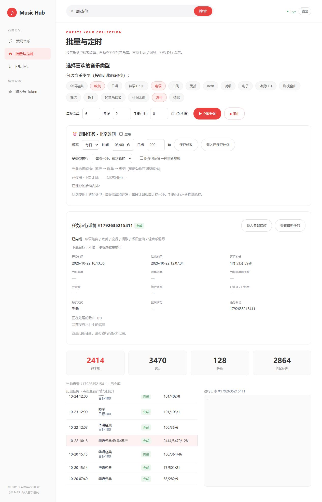
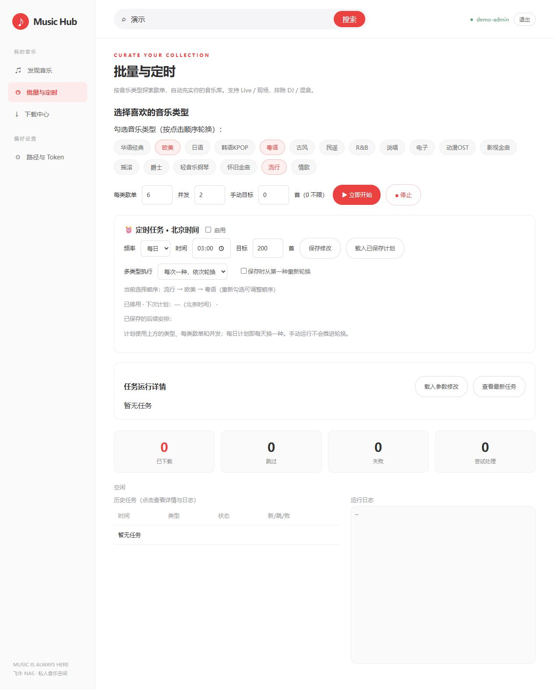

# 【开源】Music Hub：一个 Docker 容器，搞定音乐搜索、扫码登录和批量下载

平时给 NAS 补充音乐时，我希望搜索、选歌、登录平台、查看下载进度都在同一个页面完成，于是整理了这个项目：**Music Hub**。

目前已发布 **v1.0.0 单容器版**：网页、Go 下载引擎和启动初始化都装在一个镜像里，飞牛上只需要一个长期运行的容器，打开一个网页入口就能操作。

- **源码仓库**：[io-aoleo/music-hub](https://github.com/io-aoleo/music-hub)
- **版本与离线包**：[v1.0.0 发布页](https://github.com/io-aoleo/music-hub/releases/tag/v1.0.0)
- **Docker Hub 镜像**：[ioaoleo/music-hub](https://hub.docker.com/r/ioaoleo/music-hub)，安装时使用 `ioaoleo/music-hub:1.0.0`
- **备用 GHCR 镜像**：`ghcr.io/io-aoleo/music-hub:1.0.0`
- **架构**：Linux AMD64 / ARM64

> 以下使用实际界面配图：搜索来自平台实时结果，任务截图使用飞牛上真实历史记录的只读展示副本。首次设置与二维码由独立环境展示，不包含真实密码、Cookie、Token；截图中的二维码不能用于登录，请在自己的实例中重新生成。

## 先看界面：分页搜索，勾选跨页保留



*图 1：实时搜索「周杰伦」，翻到第 2 页后继续勾选，已累计选择 3 首，前一页的选择仍然保留。*

界面采用红白配色，常用功能放在左侧：发现音乐、批量与定时、下载中心、路径与 Token。

搜索支持网易云、QQ 音乐、酷我、酷狗、咪咕，可选每页 20 或 50 首，支持上一页、下一页和直接跳页。切换页面不会清空已经选中的歌曲，选好后直接提交批量下载，不需要跳到另一个项目操作。

## 一、飞牛上怎么安装

### 1. 准备项目目录和音乐目录

在飞牛文件管理里创建一个项目目录，下载仓库中的 [compose.yaml](https://github.com/io-aoleo/music-hub/blob/main/compose.yaml) 放进去。

在同一目录创建 `.env` 文件，填写**你自己设备上的真实目录**：

```dotenv
ENGINE_DOWNLOAD_PATH=/vol1/1000/music
HUB_PORT=9985
MUSIC_HUB_IMAGE=ioaoleo/music-hub:1.0.0
```

`/vol1/1000/music` 只是示例，按自己的存储卷、用户目录修改。音乐目录需要允许 UID 1000 读取、创建和写入文件。

### 2. 导入 Compose 并启动

打开飞牛 Docker 的 Compose 管理，创建项目、选择 `compose.yaml` 并启动。

也可以在项目目录用终端启动：

```sh
docker compose up -d
```

这是从 Docker Hub 拉取预构建镜像，不需要在 NAS 上安装 Python、Go 或现场编译源码。正常运行时只有一个 `music-hub-hub-1` 容器；引擎在容器内部运行，不需要单独开放端口，也不需要挂载 Docker Socket 或开启 privileged。

Docker Hub 用户名是 `ioaoleo`，GHCR 用户名是 `io-aoleo`，请勿混写。两个仓库均公开，支持 AMD64 / ARM64，无需登录即可拉取，实际速度取决于设备网络。如果 Docker Hub 不通，可把 `.env` 中的镜像改成 `ghcr.io/io-aoleo/music-hub:1.0.0` 再启动。已有实例切换仓库时，保留原 Compose 项目名和所有数据映射，只修改 `MUSIC_HUB_IMAGE` 后执行 `docker compose pull`、`docker compose up -d`。

### 3. 打开网页，创建自己的管理员

浏览器访问 `http://你的飞牛地址:9985`，第一次进入会显示创建管理员页面：



*图 2：用户名和密码由使用者自己设置，没有通用默认密码；密码至少 10 位。*

管理员用于保护 Music Hub 网页，与音乐平台账号分别管理。之后可以在设置中修改管理员密码。

## 二、目录怎么填：宿主机目录和容器目录要对应



*图 3：页面显示当前生效的映射，支持检查写入权限，以及浏览、创建和选择音乐子目录。平台凭据输入框默认留空。*

例如部署时设置：

```text
飞牛宿主机：/vol1/1000/music
容器内部：  /music
```

那么下载到容器里的 `/music/华语`，实际文件会出现在飞牛的 `/vol1/1000/music/华语`。

网页下载子目录使用 `/music` 下的路径。网页也提供宿主机目录输入框，可以生成 `.env` 配置；**更改宿主机挂载后，需要在原 Compose 项目中更新配置并重新创建容器**，不能只刷新网页或重启容器。

更换目录不会自动搬迁旧歌曲。已有曲库也不会被初始化程序递归改权限，目录不允许写入时，应先在飞牛权限管理中调整。

## 三、网易云扫码登录，不用手动复制 Token



*图 4：实际扫码登录界面。图中为演示二维码，不对应任何个人账号，也不能作为你的登录码使用。*

进入「路径与 Token」，点击「扫码登录网易云」：

1. 网页生成二维码。
2. 用网易云音乐 App 扫码，并在手机端确认。
3. 网页显示登录结果，成功后凭据自动保存在当前实例，无需再复制 Token 或点击保存。

二维码过期可以刷新，未确认时可以关闭。其他平台也可以在同一页面填写对应 Cookie；已保存的凭据不会直接回显，留空会保留原值。

**扫码登录只确认账号身份，不会增加账号原本没有的歌曲权限。** 搜索结果中出现某首歌，也不代表该账号一定能下载它。

## 四、下载进度与真实历史：完成、跳过、失败分别保留



*图 5：一条真实的按类型批量任务记录，显示已下载 2414、跳过 3470、失败 128。部分旧版运行指标没有记录，页面会显示未知；这不是所有歌曲都能下载的保证。*

上图是「批量与定时」中的历史任务详情，真实记录中成功、跳过和失败分别保留。

单曲和搜索结果多选下载进入「下载中心」，可以查看已完成、下载中、等待中、失败或中断的数量；等待中的任务可取消，失败或中断的任务可重试。

关闭网页不会停止后台下载。重启后，排队任务继续处理；正在执行但被中断的任务会保留记录，供手动重试。默认使用两个下载线程，每次最多选择 200 首。

## 五、定时自动下载怎么设置？按类型轮换补充曲库



*图 6：下方展示飞牛中的真实任务历史；上方示例选定「流行 → 欧美 → 粤语」，可每次轮换一种，也可执行全部类型。只读展示副本没有启用定时任务。*

「批量与定时」支持按音乐类型寻找歌单，设置每类歌单数量、并发和下载目标，可按每日、每周、每月执行，界面按北京时间显示计划。

这与前面的“搜索结果多选下载”是两个入口：一个适合自己选歌，一个适合按类型定时补充。计划使用前建议先手动测试一次来源、目录和平台登录状态。

### 实际启用步骤

1. 进入左侧「批量与定时」，先在上方依次勾选音乐类型，例如「流行 → 欧美 → 粤语」。点击顺序就是轮换顺序，页面会显示当前选择顺序。
2. 设置上方的「每类歌单」与「并发」，例如每类 6 个歌单、并发 2。定时计划会一并保存这些参数。
3. 在「定时任务 · 北京时间」区域勾选「启用」。仅选择类型、没有勾选启用，不会自动执行。
4. 选择频率和时间：每日填写时间；每周还要选周几；每月还要选 1～28 号。全部按北京时间（Asia/Shanghai）执行。
5. 在定时区域填写「目标」，例如 100 首，0 表示不限。这是本次定时任务的新下载目标，跳过的重复歌曲不计入新下载数量；并发下最终数量可能略超目标，也可能因资源或账号权限不足而达不到目标。
6. 选择「多类型执行」：每次一种、依次轮换，会在不同执行日依次使用勾选类型；每次执行全部类型，则在同一次任务中处理全部勾选类型，所有类型共同使用本次下载目标。
7. 如需从列表第一种类型重新开始，勾选「保存时从第一种重新轮换」。点击「保存修改」，再确认页面显示已启用、下次计划时间及后续安排。未点击保存的改动不会生效。

### 例子：每天中午自动补充约 100 首

依次选择「流行 → 欧美 → 粤语」，每类歌单填 6、并发填 2；勾选启用，频率选每日，时间填 12:00，定时目标填 100，多类型执行选「每次一种，依次轮换」，勾选从第一种重新轮换后保存。

这样下一次计划处理流行，再下一次处理欧美，之后处理粤语，然后循环。100 是每次任务的目标，不是保证一定能下载成功的数量；请以实际任务记录为准。

### 使用时注意

- 上方「手动目标」配合「立即开始」使用；下方定时区域的「目标」才控制自动任务，两者分别设置。
- 保存计划不会立即下载。保存后看「下次计划」，如果当天所选时间已经过去，下一次会排到后续符合条件的日期。
- 容器需要保持运行，关闭网页不影响计划；停机期间无法执行下载。已有按类型任务排队或运行时，调度器会等待空闲后再判断，不会重叠启动多份任务，也不会把错过的每个时间点集中补跑。
- 只有成功创建定时任务时才推进轮换；手动点击「立即开始」不会推进定时轮换。修改计划只影响未来任务，不会自动改写已经开始的任务。
- 想停用定时下载，取消勾选「启用」后点击「保存修改」。平台凭据过期或目录不可写时，应先修复配置，再查看历史记录决定是否重试。


## 六、镜像拉取慢，可以离线导入

[v1.0.0 发布页](https://github.com/io-aoleo/music-hub/releases/tag/v1.0.0) 额外提供了 AMD64 离线镜像包和 `SHA256SUMS`。下载到 NAS 后，在同一目录执行：

```sh
sha256sum -c SHA256SUMS
docker load -i music-hub-1.0.0-amd64.tar.gz
```

离线包内的镜像名为 `ghcr.io/io-aoleo/music-hub:1.0.0`；离线导入后确认 `.env` 中固定 `MUSIC_HUB_IMAGE=ghcr.io/io-aoleo/music-hub:1.0.0`，再启动：

```sh
docker compose up -d --pull never
```

离线包仅适用于 AMD64。ARM64 设备请拉取仓库中对应架构的镜像，不要导入 AMD64 包。

## 七、升级和数据保存

管理员、任务、平台配置通过数据卷持久保存，音乐保存在自己映射的目录。普通升级先备份 Compose、`.env` 和数据，再拉取镜像、重新创建容器：

```sh
docker compose pull
docker compose up -d
```

固定了版本标签时，需要先将 `.env` 的镜像版本改为要升级的版本。**不要把 `docker compose down -v` 当作普通升级命令，它会删除命名数据卷。**

从旧双容器版升级，需要保留原项目名称和数据路径，具体步骤及回退编排见仓库 README 和迁移指南。

## 关于账号数据和开源

发布镜像由 GitHub Actions 从公开源码构建，内含应用和运行依赖。管理员、音乐平台 Cookie、内部 Token 在各自部署中创建并保存，不会随公共镜像分发，也不需要使用 Google 或 Chrome 登录数据。

项目采用 **AGPL-3.0**，下载引擎基于 Go Music DL，源码、上游来源和许可说明都保留在仓库中。它是一个整理个人音乐库的工具，请仅下载和使用自己有权访问的内容；平台接口、网络、账号权限变化都可能影响下载结果。

欢迎试用。反馈问题时，建议附上设备架构、镜像版本、操作步骤和已脱敏的错误信息，**不要在帖子或 Issue 中粘贴 Cookie、Token 和管理员密码**。
